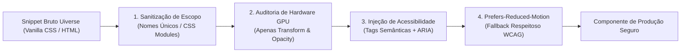

# Uiverse.io — Dossiê Técnico de Componentes & Design System

## 1. Identidade Visual & O Que Torna Único (Assinatura)

Criado e fundado pelo engenheiro de design **Adam Giebl** (`@adamgiebl`), o **Uiverse.io** consolidou-se como o maior ecossistema comunitário *open-source* do mundo dedicado a elementos de interface construídos prioritariamente em **CSS puro e Tailwind CSS sem dependência de JavaScript** (Zero-JS). Hospedando dezenas de milhares de componentes sob a licença permissiva **MIT**, a plataforma funciona como um laboratório vivo e crowdsourced de experimentação visual.

A assinatura do Uiverse.io e sua proposta no cenário global de front-end fundamentam-se em quatro pilares singulares:

### 1. A Filosofia "Zero-JS & Pure CSS Omnipresence"
A quase totalidade das bibliotecas contemporâneas de UI (como Framer Motion, Aceternity UI ou Magic UI) delega o comportamento dinâmico a pesados runtimes de JavaScript. O Uiverse trilha o caminho oposto: explora os limites técnicos da especificação CSS3 e CSS Moderno (seletores `:has()`, pseudo-classes `:checked`, `:focus-within`, pseudo-elementos `::before`/`::after`, `@keyframes`, `transform-style: preserve-3d`, `clip-path` e gradientes cônicos). Isso permite entregar micro-interações de altíssimo impacto tátil com **overhead de JavaScript estritamente igual a zero**, preservando o First Input Delay (FID), Interaction to Next Paint (INP) e o Total Blocking Time (TBT) em níveis ótimos.

### 2. A Tensão entre a Vanguarda Tátil e o Fenômeno Comunitário
Ao contrário de bibliotecas monásticas e herméticas desenhadas por um único estúdio com identidade uniforme, o Uiverse reflete a criatividade crua e descentralizada de designers e desenvolvedores do mundo inteiro. Nele convivem:
- **Neumorfismo Tátil Refinado**: Botões mecânicos táteis, interruptores com física de relevo e profundidade de sombras internas (`inset box-shadow`).
- **Cyberpunk & Glassmorphism Neon**: Cartões com bordas iluminadas por gradientes cônicos rotativos (*conic-gradient*), fundos esfumaçados com `backdrop-filter: blur()` e efeitos de reflexo prismático.
- **Micro-interações Orgânicas de Formulários**: Switches dia/noite hiper-detalhados com crateras lunares e nuvens animadas, checkboxes com corações e estrelas elásticas, e inputs com bordas fluorescentes de traço único.

### 3. Matriz Poliglota de Exportação Instantânea
A plataforma oferece a qualquer desenvolvedor a capacidade de inspecionar e copiar instantaneamente o código de qualquer componente em múltiplos formatos:
- `HTML + Vanilla CSS`: código isolado e agnóstico de frameworks, pronto para qualquer stack (PHP, Ruby on Rails, Django, WordPress ou web components puros).
- `Tailwind CSS`: tradução com classes atômicas utilitárias do Tailwind.
- `React / JSX`: empacotamento em componentes funcionais prontos para projetos Next.js e Vite.
- Integração nativa com **Figma** e ferramentas recentes de **IA Generativa** (*AI Variations* e *Edit with AI*), que permitem criar iterações estilísticas instantâneas a partir de um prompt em linguagem natural.

### 4. A Necessidade Crítica de Curadoria Técnica
Por ser aberto a contribuições de qualquer usuário, o catálogo do Uiverse é um vasto oceano contendo tanto obras-primas de engenharia CSS quanto experimentos amadores desprovidos de acessibilidade ou otimização de GPU. O domínio do Uiverse não reside em copiar cegamente seus componentes, mas em saber **garimpar, auditar a performance de renderização, sanitizar classes e injetar a semântica de acessibilidade necessária** antes da subida em ambientes de produção.

---

## 2. Cenários Ideais de Aplicação (Quando Usar)

### Nichos de Produto Prioritários

1. **Indie Hackers, Micro-SaaS & MVPs de Alta Conversão**:
   Projetos que necessitam de um diferencial estético instantâneo para capturar a atenção de investidores e usuários iniciais sem gastar semanas configurando pipelines complexos de animação 3D ou Three.js.
2. **Landing Pages de Produtos Tecnológicos & Hardware Criativo**:
   Produtos digitais de áudio, periféricos mecânicos, monitores de estúdio ou gadgets modernos que se beneficiam enormemente de botões com clique tátil 3D, interruptores físicos e cards metálicos ou foscos.
3. **Aplicações com Orçamento Rigoroso de JavaScript (Performance & Core Web Vitals)**:
   Aplicações estáticas (SSG via Astro, 11ty ou Next.js export) onde a adição de bibliotecas de animação de 50KB a 100KB degradaria métricas cruciais de SEO e performance mobile.
4. **Micro-interações de Deleite (Easter Eggs & Toggles de Configuração)**:
   Aquele interruptor solitário de alternância *Light/Dark Mode* na barra de navegação, ou o botão de "Upgrade to Pro" que pulsa suavemente na barra lateral — momentos isolados em que o usuário toca a interface e recebe um feedback recompensador.

### Papel no Ritmo Visual (Regra 60-30-10)

O maior perigo ao utilizar o Uiverse é transformar a interface em um mostruário caótico de efeitos dissonantes. A aplicação disciplinada exige seguir a regra de ouro de proporção visual:

```
┌─────────────────────────────────────────────────────────────┐
│ 60% — FUNDAÇÃO ESTRUTURAL SÓBRIA (Shadcn UI / Tailwind)      │
│      Superfícies neutras, tipografia limpa, grids e tabelas │
├──────────────────────────────────────┬──────────────────────┤
│ 30% — MICRO-INTERAÇÕES UIVERSE       │ 10% — SHOWSTOPPER    │
│      Inputs táteis, switches suaves, │      1 botão hero ou │
│      checkboxes elegantes            │      1 loader épico  │
└──────────────────────────────────────┴──────────────────────┘
```

- **60% (Fundação Estrutural Sóbria)**:
  Layouts limpos baseados em tokens neutros (Zinc, Slate ou Neutral), superfícies planas, cartões com bordas sutis (`border-zinc-800`), e tipografia funcional (`Geist Sans` ou `Inter`). Esse papel **nunca** deve vir do Uiverse; deve vir de sistemas como Shadcn UI ou Tailwind puro.
- **30% (Micro-interações de Suporte do Uiverse)**:
  Elementos atômicos de controle onde um toque mecânico eleva a percepção de qualidade: um toggle switch refinado com resposta de mola, um campo de busca com borda que se expande ao focar, ou um checkbox com animação suave de checkmark vetorial.
- **10% (Showstopper Protagonista)**:
  Exclusivamente **um** componente visualmente dramático por tela ativa. Exemplos: o botão de ação primária (CTA) na Hero Section com gradiente cônico rotativo, ou o indicador de carregamento de splash screen em formato giroscópio orbital. Mais do que isso causará fadiga visual imediata.

---

## 3. Contraindicações Explícitas (Quando NÃO Usar)

### ⚠️ Proibido em:

1. **Sistemas Corporativos B2B Densos e Telas Analíticas**:
   Em painéis financeiros, prontuários médicos ou ERPs operacionais com centenas de registros em tabelas, a inserção de botões com reflexos neon, bordas pulsantes e cartões 3D distorce a prioridade de leitura, confunde analistas e gera exaustão cognitiva.
2. **Formulários Críticos de Checkout e Autenticação Bancária**:
   Campos de número de cartão de crédito, senha e botões de transferência exigem clareza absoluta, latência visual zero e conformidade rigorosa com leitores de tela. Animações de botão que atrasam o clique ou inputs com truques de label que bloqueiam autofill do navegador são expressamente proibidos nesses fluxos.
3. **Dispositivos Móveis de Baixa Potência sob Redes Instáveis**:
   Componentes do Uiverse que abusam de `filter: blur()`, múltiplas camadas de `box-shadow` projetadas em cascata (alguns componentes usam mais de 8 sombras sobrepostas para simular néon) forçam a GPU a repintar áreas inteiras da tela a 60 FPS, elevando a temperatura do aparelho e esgotando a bateria.
4. **Projetos com Requisitos Estritos de Acessibilidade (WCAG 2.1/2.2 AA ou AAA)** sem Refatoração:
   Muitos componentes populares no Uiverse utilizam o infame truque de esconder um `<input type="checkbox">` com `display: none` ou `opacity: 0` e desenhar a interface inteira em uma tag `<span>` ou `<label>`. Sem atributos `aria-label`, suporte a navegação por teclado (`:focus-visible`) e estados de acessibilidade anunciados para leitores de tela (como NVDA ou VoiceOver), esses componentes reprovam qualquer auditoria de acessibilidade.

### ⚠️ O Fenômeno do "AI Slop" & Como Separar Joias de Aberrações

Com a explosão de geradores de código por inteligência artificial e a abertura irrestrita da plataforma, o Uiverse recebeu uma avalanche de componentes inflados — coloquialmente denominados *"AI slop"* ou "aberrações CSS". Esses componentes caracterizam-se por:
- Cores neon caóticas sem harmonia de contraste (ex: texto roxo fluorescente sobre fundo azul marinho).
- Estruturas de 20 divs aninhadas sem propósito semântico para desenhar um simples botão.
- Animações contínuas de rotação em 360 graus que rodam infinitamente consumindo ciclos de CPU mesmo com a aba inativa.

#### Checklist de 4 Passos para Garimpar Joias no Uiverse:

| Etapa de Auditoria | O Que Procurar (Sinal Verde - Joia) | O Que Rejeitar (Sinal Vermelho - Slop) |
| :--- | :--- | :--- |
| **1. Propriedades Animadas** | Anima estritamente `transform` e `opacity` (renderizadas na camada da GPU sem provocar reflow de layout). | Anima `width`, `height`, `margin`, `padding`, `top`, `left` ou `box-shadow` em loops contínuos. |
| **2. Teste da Escala de Cinza** | O componente continua visualmente coerente, equilibrado e legível quando visualizado sem o efeito de cor ou néon. | O componente desmorona e vira uma mancha confusa sem as cores berrantes; é puramente pirotecnia visual. |
| **3. Densidade de Marcação** | Marcação semântica enxuta (`<button>`, `<label>`, `<input>`) com no máximo 1 ou 2 pseudo-elementos decorativos. | Mais de 6 divs auxiliares (`<div class="star-1">`, `<div class="glow-bg">`, etc.) para produzir uma borda básica. |
| **4. Isolamento e Scoping** | Classes com nomes específicos ou facilmente convertíveis para Tailwind / CSS Modules. | Seletores globais intrusivos que poluem o projeto (ex: regras diretas aplicadas a `body`, `button` ou `*`). |

---

## 4. Catálogo Detalhado de Componentes Notáveis (Showstoppers & Primitivas)

Abaixo estão 10 das criações e padrões mais emblemáticos garimpados do ecossistema Uiverse.io, organizados por anatomia, interação e posicionamento:

```
   ┌───────────────────────────────────────────────────────────────┐
   │ 1. Cyberpunk Conic-Glow Button      [Hover: Conic Sweep]     │
   │ 2. Mechanical 3D Pushable Button    [Active: Y-Depress 4px]  │
   │ 3. Realistic Day/Night Switch       [Click: Lunar Cycle]     │
   │ 4. Ray-Traced Glassmorphism Card    [Hover: Specular Glow]   │
   │ 5. Tactical Floating Label Input    [Focus: Track Trace]     │
   │ 6. Gyroscopic Orbital Loader        [Continuous: 3D Axis]    │
   │ 7. Spring Elastic Heart Checkbox    [Check: Pulse & Pop]     │
   │ 8. Ambient Light Ray Bento Card     [Hover: Angle Sheen]     │
   │ 9. Radar Ping Pulse Indicator       [Continuous: Wave Loop]  │
   │ 10. Spring-Scale Zero-JS Tooltip    [Hover: Cubic-Overshoot] │
   └───────────────────────────────────────────────────────────────┘
```

### 1. Cyberpunk Conic-Glow Button (Botão com Borda Néon Rotativa)
- **Anatomia Visual**: Botão escuro de alto contraste sobre o qual corre uma fina borda luminescente contínua, gerada por um gradiente cônico rotativo mascarado em um pseudo-elemento `::before`, com fundo interno preservado via `background-clip` ou camada interna sobreposta.
- **Gatilho de Interação**: Animação contínua de rotação em baixa velocidade (4s a 6s) que acelera suavemente no `:hover`, acompanhada de uma expansão sutil do brilho difuso (*glow*).
- **Onde Encaixar**: Botão principal de Call to Action (CTA) na Hero Section de landing pages de produtos de IA, plataformas Web3 ou ferramentas de segurança digital.

### 2. Mechanical 3D Pushable Tactical Button (Botão Mecânico com Profundidade Real)
- **Anatomia Visual**: Inspirado em teclados mecânicos e consoles industriais. Composto por uma base de sombra sólida inferior (`edge`), uma face superior chanfrada (`front`) e um efeito de relevo físico real com gradiente linear sutil.
- **Gatilho de Interação**: No `:hover`, a face se eleva 2px adicionais; no `:active` (clique), a face superior é transladada para baixo em `translateY(4px)` ou `6px`, encontrando a base sólida e gerando a sensação instantânea de um interruptor físico tátil sendo acionado.
- **Onde Encaixar**: Botões de ação definitiva de alta relevância, como "Deploy Now", "Iniciar Download", botões de checkout gamer ou telas de confirmação de transação em produtos criativos.

### 3. Realistic Day/Night Toggle Switch (Interruptor Solar/Lunar Hiper-Realista)
- **Anatomia Visual**: Interruptor em formato de pílula que transiciona de um céu azul ensolarado com nuvens brancas volumétricas para um céu azul-marinho profundo estrelado, com uma lua cheia repleta de crateras sombreadas em CSS puro.
- **Gatilho de Interação**: No `:checked` (click/tap), o sol se move horizontalmente, perde o brilho amarelo e rotaciona revelando a face lunar sombreada com crateras através de `box-shadow` internas e transições de coordenadas espaciais. As estrelas emergem através de `opacity` e `scale`.
- **Onde Encaixar**: Seletor de tema claro/escuro na Navbar principal de portfólios, sites conceituais ou aplicações para desenvolvedores.

### 4. Ray-Traced Glassmorphism Card (Cartão Fosco com Reflexo Especular)
- **Anatomia Visual**: Container com superfície translúcida (`backdrop-filter: blur(16px)`), borda de 1px com gradiente translúcido de branco (`rgba(255,255,255,0.15)`) para transparente, e uma iluminação especular que percorre a borda superior imitando vidro óptico lapidado.
- **Gatilho de Interação**: No `:hover`, um gradiente radial acoplado ao pseudo-elemento `::after` projeta um brilho suave central, enquanto o cartão se projeta ligeiramente em direção ao usuário com `transform: translateY(-4px) scale(1.01)`.
- **Onde Encaixar**: Cards de destaque em Bento Grids, cartões de planos em tabelas de preços (*Pricing Tier Pro*) ou vitrines de recursos principais de um produto.

### 5. Tactical Floating Label Input (Campo de Texto com Borda em Traço Contínuo)
- **Anatomia Visual**: Campo de formulário minimalista escuro com rótulo (*label*) flutuante que descansa centralizado no espaço do placeholder e, ao receber foco ou preenchimento, migra para a borda superior diminuindo de escala de maneira perfeitamente sincronizada.
- **Gatilho de Interação**: Foco do teclado ou clique do mouse (`:focus-within` / `:not(:placeholder-shown)`). A linha de base inferior se expande lateralmente de 0% para 100% de largura usando `transform: scaleX(1)`, e a cor da borda migra de cinza neutro para a cor de acento da marca.
- **Onde Encaixar**: Formulários de newsletter em landing pages, caixas de busca global (`Command Bar`) ou formulários de contato em portfólios profissionais.

### 6. Gyroscopic Orbital CSS Loader (Carregador Espacial sem JavaScript)
- **Anatomia Visual**: Três anéis circulares concêntricos desenhados em CSS puro que giram em eixos tridimensionais distintos (`rotateX`, `rotateY`, `rotateZ`) com velocidades ligeiramente defasadas, simulando um giroscópio de navegação aeroespacial.
- **Gatilho de Interação**: Animação contínua `@keyframes` que emprega `transform-style: preserve-3d` e perspectiva CSS.
- **Onde Encaixar**: Splash screens de carregamento inicial de aplicações web, estados suspensos de processamento de pipelines de dados ou telas de geração de relatórios de IA.

### 7. Spring Elastic Heart Checkbox (Checkbox Tátil com Micro-Explosão)
- **Anatomia Visual**: Substituição do checkbox quadrado padrão por um glifo de coração ou marcador vetorial que, ao ser marcado, dispara um efeito de "pop" com expansão elástica e anéis de partículas que se dissipam ao redor.
- **Gatilho de Interação**: Estado `:checked` do input nativo oculto de forma acessível. O ícone sofre uma contração rápida para 0.8x de escala e salta para 1.3x antes de repousar em 1.0x utilizando uma curva `cubic-bezier(0.175, 0.885, 0.32, 1.275)`.
- **Onde Encaixar**: Botões de curtir/favoritar em cartões de produtos de e-commerce, listas de tarefas dinâmicas ou interfaces sociais.

### 8. Ambient Light Ray Bento Card (Cartão Bento com Varredura de Luz Ambiente)
- **Anatomia Visual**: Bloco retangular de canto arredondado profundo (`rounded-2xl` ou `rounded-3xl`) que possui uma textura de fundo sutil de grade matemática ou ruído (*noise*) e uma linha luminosa diagonal tênue que corta o cartão.
- **Gatilho de Interação**: No `:hover`, o feixe de luz translúcido varre a superfície de ponta a ponta (`translate3d(100%, 100%, 0)`), iluminando momentaneamente ícones e textos internos através de regras CSS de `mix-blend-mode: overlay`.
- **Onde Encaixar**: Grade Bento de apresentação de recursos em produtos SaaS modernos e portfólios de agências digitais.

### 9. Radar Ping Pulse Indicator (Indicador de Status com Eco Radial)
- **Anatomia Visual**: Ponto circular de cor viva (verde-esmeralda para "Online", âmbar para "Manutenção", vermelho para "Incidente") rodeado por múltiplos anéis concêntricos que se expandem e desvanecem suavemente.
- **Gatilho de Interação**: Animação contínua `@keyframes` que escala o anel de `scale(1)` a `scale(2.5)` enquanto transiciona a opacidade de `0.75` para `0`.
- **Onde Encaixar**: Badges de status de sistemas em tempo real, monitoramento de saúde de servidores, status de agentes de inteligência artificial ativos ou indicadores de gravação de áudio.

### 10. Spring-Scale Zero-JS Tooltip (Tooltip com Escala Elástica Pura)
- **Anatomia Visual**: Balão informativo compacto escuro com ponta de seta triangular perfeitamente alinhada, repousando de modo invisível sobre ou sob o elemento hospedeiro.
- **Gatilho de Interação**: Acionado exclusivamente por CSS via `:hover` e `:focus-visible` no elemento pai. Revela-se com um salto elástico de escala (`transform: scale(0.9) translateY(4px)` para `scale(1) translateY(0)`) e opacidade de 0 para 1 em 150ms.
- **Onde Encaixar**: Dicas de ajuda contextual ao lado de termos técnicos, ícones de barras de ferramentas compactas e botões de atalhos de teclado.

---

## 5. Arquitetura Técnica, Instalação & Receitas de Implementação

### Protocolo de Sanitização para Projetos Modernos (Next.js / Tailwind / React)

Ao migrar qualquer snippet do Uiverse.io para uma aplicação profissional, **nunca cole o código de forma ingênua**. Execute sempre as quatro etapas de higienização arquitetural:



1. **Higienização de Escopo & Prevenção de Conflitos Globais**:
   Muitos criadores utilizam nomes genéricos como `.card`, `.btn`, `.loader` ou `@keyframes spin`. Em projetos Next.js ou Vite, esses nomes entram em colisão com o restante da aplicação. Converta-os para classes atômicas do Tailwind, Styled JSX escopado, ou adicione prefixos semânticos (ex: `.uiv-tactile-btn`, `@keyframes uiv-conic-rotate`).
2. **Substituição de Animações de Alto Custo Computacional**:
   Se o componente animar `box-shadow` em loop contínuo, substitua a animação direta da sombra por um pseudo-elemento `::after` com a sombra estática pré-calculada, animando estritamente a `opacity` do pseudo-elemento. Essa simples conversão reduz o consumo de CPU em até 85%.
3. **Reestruturação Acessível (A11y)**:
   Se o componente for um botão, assegure-se de que a tag raiz seja `<button type="button">` (ou contenha `role="button"` com `tabIndex={0}` e tratador de teclado para `Enter`/`Space`). Se for um switch/checkbox, mantenha o input real no DOM utilizando classes utilitárias de leitor de tela (como `sr-only` no Tailwind), conectando-o via `id` e `htmlFor` ao seu `<label>`.
4. **Respeito à Mídia de Movimento Reduzido**:
   Inclua obrigatoriamente a regra `@media (prefers-reduced-motion: reduce)` para cancelar rotações infinitas ou substituí-las por transições suaves de opacidade estática.

---

### Física de Movimento no CSS Puro (Fórmulas & Interpolações)

Diferente do ecossistema JS que depende de solucionadores numéricos de mola física (`stiffness`, `damping`, `mass`), o CSS puro utiliza curvas de Bezier cúbicas (`cubic-bezier(x1, y1, x2, y2)`). Para emular sensações táteis realistas sem JavaScript, utilize a seguinte biblioteca de curvas calibradas:

#### Matriz de Curvas Bezier Tácteis para CSS:

| Curva Bezier | Nome Sensorial | Comportamento Físico | Caso de Uso Ideal |
| :--- | :--- | :--- | :--- |
| `cubic-bezier(0.16, 1, 0.3, 1)` | **Hyper-Snappy Decelerate** | Arrancada quase instantânea seguida de frenagem suave e controlada. | Abertura de tooltips, expansão de inputs e dropdowns rápidos. |
| `cubic-bezier(0.34, 1.56, 0.64, 1)` | **Mechanical Spring Pop** | Ultrapassa a escala de destino (*overshoot* de 156%) e retorna ao repouso. | Efeito de "pop" em botões mecânicos, checkboxes e ícones de like. |
| `cubic-bezier(0.175, 0.885, 0.32, 1.275)` | **Elastic Snap (Rebound)** | Pequena antecipação regressiva seguida de avanço com ressalto suave. | Interruptores táteis (switches) e botões que "afundam" e saltam. |
| `cubic-bezier(0.4, 0, 0.2, 1)` | **Material Standard Smooth** | Aceleração e desaceleração simétrica e sóbria para transições neutras. | Mudanças de cor de fundo, estados de borda e transições de opacidade. |

---

### Receita de Código Funcional 1: Cyberpunk Conic-Glow Button (React + Tailwind v3/v4 Sanitizado)

Este é um dos componentes mais procurados do Uiverse, totalmente refatorado com acessibilidade nativa, isolamento de escopo, otimização de compositor GPU e suporte a `prefers-reduced-motion`:

```tsx
// components/ui/cyberpunk-conic-button.tsx
"use client";

import React from "react";

interface CyberpunkConicButtonProps
  extends React.ButtonHTMLAttributes<HTMLButtonElement> {
  children: React.ReactNode;
  glowColor?: string; // Cor do feixe de luz
  className?: string;
}

export function CyberpunkConicButton({
  children,
  glowColor = "#00f0ff",
  className = "",
  ...props
}: CyberpunkConicButtonProps) {
  return (
    <button
      {...props}
      className={`
        group relative inline-flex items-center justify-center
        overflow-hidden rounded-xl p-[2px] font-mono text-sm font-semibold
        transition-transform duration-200 active:scale-95
        focus-visible:outline-none focus-visible:ring-2 focus-visible:ring-cyan-400 focus-visible:ring-offset-2 focus-visible:ring-offset-zinc-950
        disabled:cursor-not-allowed disabled:opacity-50
        ${className}
      `}
    >
      {/* 
        CAMADA 1: Gradiente cônico rotativo na GPU via pseudo-conteúdo.
        O uso de translateZ(0) garante isolamento em camada própria de composição.
      */}
      <span
        aria-hidden="true"
        className="
          absolute inset-[-1000%] 
          animate-[uiv-conic-spin_4s_linear_infinite]
          motion-reduce:animate-none
          group-hover:animate-[uiv-conic-spin_2s_linear_infinite]
          [transform:translateZ(0)]
        "
        style={{
          background: `conic-gradient(from 90deg at 50% 50%, #00000000 0%, #00000000 70%, ${glowColor} 95%, #ffffff 100%)`,
        }}
      />

      {/* 
        CAMADA 2: Superfície interna escura com textura e texto.
        Garante alto contraste (WCAG AAA) com o texto branco.
      */}
      <span
        className="
          relative flex h-full w-full items-center justify-center gap-2
          rounded-[10px] bg-zinc-950 px-6 py-3 text-zinc-100
          transition-colors duration-200
          group-hover:bg-zinc-900 group-hover:text-white
        "
      >
        {children}
      </span>
    </button>
  );
}
```

#### Adição necessária no arquivo `tailwind.config.ts` ou CSS Global:

```css
/* Adicione aos estilos globais para suportar a rotação sem poluição de nomes */
@keyframes uiv-conic-spin {
  from {
    transform: rotate(0deg);
  }
  to {
    transform: rotate(360deg);
  }
}
```

---

### Receita de Código Funcional 2: Tactile Skeuomorphic Toggle Switch (CSS Puro + A11y)

Exemplo emblemático de um switch do Uiverse higienizado com acessibilidade para teclado e leitor de tela, sem uma única linha de JavaScript:

```tsx
// components/ui/tactile-switch.tsx
"use client";

import React, { useId } from "react";

interface TactileSwitchProps {
  label: string;
  checked?: boolean;
  defaultChecked?: boolean;
  onChange?: (e: React.ChangeEvent<HTMLInputElement>) => void;
  disabled?: boolean;
}

export function TactileSwitch({
  label,
  checked,
  defaultChecked,
  onChange,
  disabled = false,
}: TactileSwitchProps) {
  const switchId = useId();

  return (
    <div className="inline-flex items-center gap-3 select-none">
      <div className="relative inline-block h-7 w-13">
        {/* Input nativo oculto de forma acessível para leitores de tela */}
        <input
          id={switchId}
          type="checkbox"
          role="switch"
          aria-checked={checked}
          checked={checked}
          defaultChecked={defaultChecked}
          onChange={onChange}
          disabled={disabled}
          className="peer sr-only"
        />

        {/* 
          Trilho do interruptor:
          Transição de sombra interna mecânica e cor com suporte a focus-visible 
        */}
        <label
          htmlFor={switchId}
          className="
            block h-full w-full cursor-pointer rounded-full bg-zinc-800 p-1
            shadow-[inset_0_2px_4px_rgba(0,0,0,0.6)]
            transition-colors duration-300 ease-[cubic-bezier(0.4,0,0.2,1)]
            peer-checked:bg-emerald-600
            peer-focus-visible:ring-2 peer-focus-visible:ring-emerald-400 peer-focus-visible:ring-offset-2 peer-focus-visible:ring-offset-zinc-950
            peer-disabled:cursor-not-allowed peer-disabled:opacity-40
          "
        >
          {/* 
            Botão interno do interruptor:
            Física de deslocamento com curva elástica cúbica de ressalto
          */}
          <span
            className="
              block h-5 w-5 rounded-full bg-zinc-200
              shadow-[0_2px_4px_rgba(0,0,0,0.4),inset_0_-1px_1px_rgba(0,0,0,0.2)]
              transition-transform duration-300 ease-[cubic-bezier(0.34,1.56,0.64,1)]
              peer-checked:translate-x-6 peer-checked:bg-white
              motion-reduce:transition-none
            "
          />
        </label>
      </div>

      <label
        htmlFor={switchId}
        className="cursor-pointer text-sm font-medium text-zinc-300 hover:text-white"
      >
        {label}
      </label>
    </div>
  );
}
```

---

## 6. Diretrizes para o `DESIGN_BLUEPRINT.md`

Ao redigir o documento de arquitetura de interface (`DESIGN_BLUEPRINT.md`) para novos projetos, instrua os agentes de IA e engenheiros a aplicarem as seguintes diretrizes estritas:

### 1. Critérios de Elegibilidade de Componentes do Uiverse
- **Permitido**: Utilizar componentes do Uiverse para **micro-interações táteis isoladas** (switches de configurações, botões de ação com física 3D, badges com pulsos de status, tooltips sem dependência de runtime JS).
- **Mandatório**: Todo componente trazido do Uiverse deve passar pelo processo de sanitização de escopo e acessibilidade (restauração de tags semânticas `<button>`, `<input>`, rótulos ARIA e tratamento para `prefers-reduced-motion`).
- **Restrito a 1 Showstopper**: No máximo **um elemento dramático** do Uiverse por tela ou fluxo de navegação ativo.

### 2. Matriz de Decisão Arquitetural: Uiverse vs Alternativas

| Demanda do Projeto | Biblioteca Recomendada | Papel do Uiverse |
| :--- | :--- | :--- |
| **Estrutura, Diálogos, Dropdowns & A11y** | **Shadcn UI / Radix Primitives** | Nenhum. Deixe a estrutura neutra e acessível para o Shadcn. |
| **Animações Orquestradas por Scroll & Shaders WebGL** | **React Bits / Magic UI** | Nenhum. O Uiverse não substitui renderizadores de Canvas/WebGL. |
| **Botão de Ação Primária Tátil (CTA Showstopper)** | **Uiverse.io** | **Recomendado**. Pegue o CSS puro, converta para Tailwind e aplique no CTA. |
| **Toggle Switches Táteis & Checkboxes de Deleite** | **Uiverse.io** | **Recomendado**. Economiza 40KB de dependências JS de micro-mola. |
| **Spinners e Loaders Esculturais sem Runtime JS** | **Uiverse.io** | **Recomendado**. Ideal para páginas estáticas e splash screens. |

### 3. Regra de Ouro de Higiene de Código
> "No `DESIGN_BLUEPRINT.md`, nenhum snippet de CSS bruto do Uiverse deve ser declarado sem a respectiva renomeação de `@keyframes` e sem o encapsulamento em um componente TypeScript funcional. A biblioteca deve ser tratada como uma pedreira de joias brutas que exigem lapidação técnica antes de tocarem a base de código do produto."
