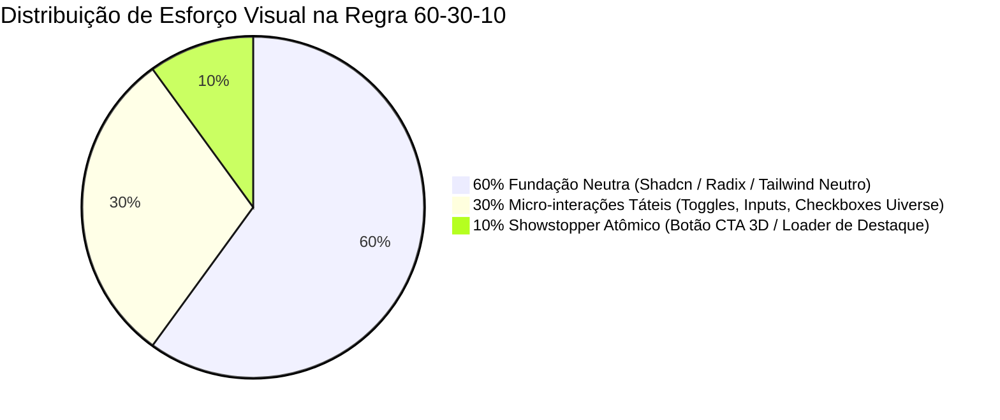

# Uiverse Elements — Dossiê Técnico de Componentes & Design System

## 1. Identidade Visual & O Que Torna Único (Assinatura)

O **Uiverse Elements** (`https://uiverse.io/elements`), fundado por **Adam Giebl** e impulsionado pelo ecossistema aberto da comunidade mundial no repositório `uiverse-io/galaxy`, representa o ápice da **expressão atômica em CSS puro e Tailwind CSS**. Trata-se da maior galáxia descentralizada de componentes primitivos da web moderna — com foco primordial em botões táteis, caixas de seleção animadas, interruptores (*toggles*), campos de formulário dinâmicos, cartões reflexivos e indicadores de carregamento (*loaders*).

Enquanto os design systems corporativos tradicionais (Material UI, Ant Design, Chakra UI) padronizam botões e inputs como caixas planas utilitárias quase imperceptíveis, o Uiverse os eleva a **peças de alta relojoaria visual e engenharia mecânica digital**.

```
┌────────────────────────────────────────────────────────────────────────┐
│                   ASSINATURA VISUAL DO UIVERSE ELEMENTS                │
├────────────────────────────────┬───────────────────────────────────────┤
│ 1. Física Tátil Mecânica       │ Botões 3D que afundam fisicamente     │
│    (3D Arcade & Push-Depth)    │ colapsando sombras duras no :active    │
├────────────────────────────────┼───────────────────────────────────────┤
│ 2. CSS-Only State Machines     │ Alternância sem JavaScript usando     │
│    (Checkbox & Pseudo Hacks)   │ :checked, :has(), ::before/::after    │
├────────────────────────────────┼───────────────────────────────────────┤
│ 3. Geometria Cortada & Sci-Fi  │ Chanfros em 45° via clip-path e       │
│    (Cyberpunk Glitch & Neon)   │ feixes luminosos com drop-shadow      │
├────────────────────────────────┼───────────────────────────────────────┤
│ 4. Traçado Vetorial Dinâmico   │ Checkboxes desenhados via SVG stroke   │
│    (SVG Stroke Morphing)       │ dasharray e dashoffset interpolados   │
├────────────────────────────────┼───────────────────────────────────────┤
│ 5. Efeito Zero Runtime JS      │ 95%+ dos elementos rodam 100% na GPU  │
│    (Zero-Overhead CSS Native)  │ via transform, opacity e keyframes    │
└────────────────────────────────┴───────────────────────────────────────┘
```

### O Que Torna o Uiverse Elements Inconfundível

1. **Aceleração Nativa por Hardware sem Sobrecarga de Runtime**:
   A vasta maioria dos componentes do Uiverse não exige bibliotecas de animação pesadas (como Lottie ou Three.js) nem listeners de eventos no JavaScript. Quase toda a complexidade cinemática é expressa via CSS puro — aproveitando as propriedades `transform`, `opacity` e `filter`, que são delegadas diretamente para o compositor da GPU. Isso garante 60 a 120 FPS cravados mesmo em telas de dispositivos móveis modestos.

2. **Engenharia de Sombras Multicamadas & Profundidade Neumórfica**:
   O Uiverse dominou o cálculo óptico de elevações:
   - Sombras projetadas e internas combinadas (`box-shadow: inset ... , ...`) para simular superfícies côncavas e convexas.
   - Sombras de projeção rígida sem desfoque (`box-shadow: 0 6px 0 var(--shadow-color)`) que recriam o impacto tátil de consoles retrô e botões industriais.
   - Halos de dispersão cromática com múltiplos níveis de `drop-shadow(0 0 12px rgba(...))` para emular tubos de neon e displays analógicos fluorescentes.

3. **Coreografia de Pseudo-elementos (`::before` e `::after`)**:
   Elementos atômicos simples (como uma tag `<button>` ou `<label>`) recebem camadas ópticas complementares sem sujar a árvore DOM. Os pseudo-elementos são frequentemente utilizados para criar brilhos passantes (*shimmer sheens*), fundos em gradiente cônico rotativo, chanfros recortados e bordas reflexivas com gradiente translúcido.

4. **Transições Orgânicas com o Hack de `:checked` e `:has()`**:
   Switches e checkboxes do Uiverse funcionam como máquinas de estado autônomas no CSS. O input nativo fica invisível sob acessibilidade semântica, enquanto elementos adjacentes reagem via seletores irmãos (`input:checked ~ .indicator` ou o moderno `:has(:checked)`), acionando transições elásticas imediatas.

---

## 2. Cenários Ideais de Aplicação (Quando Usar)

### Nichos de Produto Recomendados

1. **Plataformas de Inteligência Artificial & Agentes Autônomos**:
   - Botões de prompt ("Generate", "Execute Prompt", "Deploy Agent") que precisam comunicar alta densidade de processamento através de gradientes vivos, pulsos de energia e micro-animações táteis no clique.
   - Loaders em CSS puro que mantêm o usuário visualmente engajado enquanto modelos de linguagem (LLMs) executam raciocínios em streaming.
2. **Developer Tools, Terminais Web & Plataformas Cloud**:
   - Ambientes com estética Hacker, Cyberpunk ou Dark Craft (interfaces de linha de comando na web, dashboards de observabilidade e consoles de infraestrutura) que se beneficiam de botões chanfrados, loaders em formato de terminal/glitch e inputs com visual de telemetria.
3. **Web3, Fintechs Cripto & Plataformas Gamificadas**:
   - Botões "Connect Wallet", "Mint Token", seletores de rede e painéis de staking onde o design lúdico, botões 3D com peso mecânico e badges holográficos aumentam a dopamina da interação e transmitem valor de produto digital moderno.
4. **Landing Pages de Alto Impacto & Portfólios de Design Engineers**:
   - Páginas que precisam demonstrar criatividade técnica nos primeiros 3 segundos. O botão de chamada para ação (CTA) principal e os cards de recursos ganham vida imediata ao integrar componentes do Uiverse.
5. **E-commerces de Streetwear, Moda Urbana e Equipamentos Tech**:
   - Lojas com apelo visual jovem e disruptivo, onde botões planos convencionais parecem frios e desinteressantes.

### Papel no Ritmo Visual (Regra 60-30-10)



- **60% (Fundação Neutra e Estrutural)**: A infraestrutura do layout — tipografia com `Inter` ou `Geist Sans`, paleta de cinzas profundos (`zinc-900` / `zinc-950`), containers, tabelas de dados e espaçamento modular rígido. Mantenha os elementos auxiliares limpos e funcionais.
- **30% (Micro-interações Táteis do Uiverse)**: Adote interruptores de tema (Day/Night toggles com animação de sol e lua), caixas de seleção com traçado vetorial suave SVG e campos de texto com floating label animado. Isso traz elegância e prazer sem poluir a visão.
- **10% (Showstopper Atômico do Uiverse)**: Reserve o elemento mais expressivo (o botão 3D arcade com afundamento mecânico, o botão cyberpunk com laser sweep, ou o loader cinético orbital) exclusivamente para o **ponto focal supremo** da página: o CTA da seção Hero, o botão de finalização de compra, ou o modal de processamento de IA.

---

## 3. Contraindicações Explícitas (Quando NÃO Usar)

### ⚠️ Proibido em:

- **Sistemas Corporativos Legados & ERPs Densos**:
  Interfaces administrativas com centenas de linhas de dados, planilhas financeiras de conciliação ou prontuários médicos. Nesses cenários, botões que afundam 6px ou toggles temáticos causam poluição visual, aumentam a altura da linha e distraem o operador que necessita de velocidade pura e previsibilidade estrita.
- **Portais Governamentais e Aplicações com Mandato WCAG AAA Rígido Sem Revisão**:
  Muitos elementos do repositório da comunidade do Uiverse foram desenhados com foco em estética visual e utilizam truques de CSS que removem o contorno nativo de foco (`outline: none`) ou utilizam combinações de cores com baixo contraste cromático. **Não copie elementos do Uiverse diretamente para ambientes de conformidade crítica sem antes higienizar os atributos de acessibilidade.**
- **Interfaces com Navegação Rápida por Teclado sem Focus Ring Customizado**:
  Se um botão customizado do Uiverse remover o `:focus-visible` sem fornecer uma alternativa nítida, usuários de tecnologia assistiva e navegação motora por tabulação ficarão completamente desorientados.

### ⚠️ Erros Comuns de Exagero (Anti-Padrões & "AI Slop"):

> [!WARNING]
> **Anti-Padrão: A "Feira Livre de Estilos"**  
> O maior erro de juniores e IAs ao usar o Uiverse é selecionar 5 elementos incríveis de autores diferentes e jogá-los na mesma tela: um botão cyberpunk neon, um toggle neumórfico cinza fofo, um checkbox de madeira retrô e um loader de buraco negro. Cada componente é uma obra de arte individual, mas combinados geram uma cacofonia visual amadora. Escolha uma única direção temática (ex: *Dark Craft Cibernético*) e aplique variações da mesma paleta.

- **Animando Propriedades de Fluxo (Layout Thrashing)**:
  Evite modificar componentes do Uiverse que animam `height`, `width`, `top` ou `margin`. Se encontrar um componente que faça isso, refatore-o imediatamente para usar `transform: translate3d(...)` ou `scale()`, garantindo que o navegador não recalcule o layout da página a cada frame.
- **Ignorância Semântica (Divitis Aguda)**:
  Substituir elementos semânticos (`<button>`, `<input type="checkbox">`, `<label>`) por `<div>` puras apenas para colar o CSS do Uiverse. Isso quebra leitores de tela, perde eventos de formulário nativos e destrói a acessibilidade do produto.

---

## 4. Catálogo Detalhado de Componentes Notáveis (Showstoppers & Primitivas)

Abaixo estão os 10 padrões de componentes mais emblemáticos do catálogo atômico do Uiverse Elements:

---

### 1. 3D Tactile Arcade Push Button (Botão Mecânico com Profundidade Rígida)

```
       ESTADO DEFAULT (Normal)                 ESTADO ACTIVE (Pressionado)
  ┌───────────────────────────────┐        ┌───────────────────────────────┐
  │     ⚡ INICIAR EXPERIMENTO    │        │                               │
  ├───────────────────────────────┤        │     ⚡ INICIAR EXPERIMENTO    │
  │  Base Rígida (6px de sombra)  │        ├───────────────────────────────┤
  └───────────────────────────────┘        │  Base Colapsada (0px sombra)  │
                                           └───────────────────────────────┘
```

- **Anatomia Visual**: Composto por duas camadas sobrepostas — uma base inferior sólida com cor saturada e uma face superior móvel com borda arredondada (`rounded-xl`). A face superior projeta uma sombra dura vertical sem desfoque (`box-shadow: 0 6px 0 var(--border-color)`). No estado `:hover`, a face se eleva levemente (1px). No estado `:active`, sofre uma translação vertical de 6px (`transform: translateY(6px)`), colapsando a sombra a zero, simulando com perfeição mecânica o clique de um botão de fliperama arcade ou switch Cherry MX.
- **Gatilho de Interação**: Hover e clique (`:active` / `pointerdown`).
- **Onde encaixar na página**: Botão de CTA primário na seção Hero, botão de checkout em e-commerce moderno e botão de disparo em ferramentas de IA.

---

### 2. SVG Stroke-Dasharray Animated Checkbox (Caixa de Seleção com Traço Dinâmico)

- **Anatomia Visual**: Substitui o checkbox cinza nativo por um container minimalista arredondado contendo um caminho SVG (`<path d="M..."/>`) em formato de checkmark. O traço do vetor possui comprimento calibrado via `stroke-dasharray` e começa oculto com `stroke-dashoffset` igual ao comprimento total. Ao marcar a caixa, o offset é animado suavemente para 0, criando a ilusão hipnótica de que uma caneta digital está desenhando o símbolo de verificação em tempo real.
- **Gatilho de Interação**: Clique no checkbox / tecla Espaço (`input:checked`).
- **Onde encaixar na página**: Listas de tarefas interativas, etapas de formulários de onboarding, caixas de concordância de termos de uso e filtros de busca refinada.

---

### 3. Cyberpunk Angled Bevel Button (Botão Futurista Chanfrado com Glitch)

- **Anatomia Visual**: Geometria angular não-retangular obtida por máscara de recorte CSS (`clip-path: polygon(12px 0, 100% 0, 100% calc(100% - 12px), calc(100% - 12px) 100%, 0 100%, 0 12px)`). Possui bordas em tom ciano brilhante (`#00f0ff`) ou amarelo cyberpunk, complementadas por um feixe de luz vertical em pseudo-elemento e micro-glitch de deslocamento cromático RGB quando o cursor repousa sobre a superfície.
- **Gatilho de Interação**: `:hover` e `:focus-visible`.
- **Onde encaixar na página**: Botão "Connect Wallet" em dApps, botão "Launch Console" em plataformas de nuvem e headers de jogos web.

---

### 4. Sliding Day & Night Toggle Switch (Chave Sol/Lua com Efeito Planetário)

- **Anatomia Visual**: Um interruptor largo com fundo degradê que viaja do azul celeste ensolarado ao azul meia-noite estrelado. O manipulo deslizante representa o astro solar (dourado e circular) que, ao ser alternado, translada para a direita, ganha tonalidade prateada e revela crateras lunares via pseudo-elementos e sombras internas, enquanto micro-estrelas aparecem cintilando no fundo.
- **Gatilho de Interação**: Clique ou tecla Enter/Espaço no switch (`:checked`).
- **Onde encaixar na página**: Alternador de tema Claro/Escuro na barra de navegação superior (Navbar) ou menu de configurações da conta do usuário.

---

### 5. Floating Label Outline Input com Expansão de Borda

- **Anatomia Visual**: Campo de entrada de texto moderno onde o rótulo descritivo repousa inicialmente no interior do input como placeholder. Quando o usuário clica ou o campo recebe conteúdo (`:focus`, `:not(:placeholder-shown)`), o texto sobe suavemente com redução de escala (`scale(0.85)` e `translateY(-140%)`), acomodando-se exatamente sobre a borda superior, enquanto a linha perimetral se ilumina em cor de destaque primário.
- **Gatilho de Interação**: Foco do teclado (`:focus-within`) e digitação (`input`).
- **Onde encaixar na página**: Formulários de autenticação (Login / Registro), campos de newsletter no rodapé e painéis de configuração de perfil.

---

### 6. Pure CSS Newton's Cradle Loader (Pêndulo de Newton Cinético)

- **Anatomia Visual**: Cinco esferas metálicas suspensas simulando o clássico experimento de física de conservação de momento. A primeira esfera da esquerda balança em arco, atinge as três esferas centrais (que permanecem quase estáticas), transferindo a força para a quinta esfera da direita que sobe em reflexo perfeito. Construído com 5 tags `<span>` e CSS Keyframes puros sem uma linha de script.
- **Gatilho de Interação**: Auto-play contínuo durante estados de carregamento assíncrono.
- **Onde encaixar na página**: Telas de splash de carregamento inicial, modal de processamento de pagamento ou estado de espera de geração de relatórios pesados.

---

### 7. Holographic Rainbow Foil Card (Cartão com Reflexo de Folha Holográfica)

- **Anatomia Visual**: Superfície escura de cartão VIP que contém uma camada reflexiva em gradiente cônico angular multicolorido com modo de mistura `mix-blend-mode: color-dodge` e padrão de ruído sutil. Conforme o mouse se desloca sobre a superfície, a luz furta-cor se move em sentido contrário ao ponteiro, emulando com precisão o acabamento de cartas colecionáveis raras ou cartões bancários de titânio.
- **Gatilho de Interação**: `:hover` e rastreamento de mouse via CSS variables inline (`--x`, `--y`).
- **Onde encaixar na página**: Cartão de plano "Enterprise / Pro Tier" na tabela de preços, cartões de certificados de conclusão em plataformas EdTech e badges comemorativos.

---

### 8. Neumorphic Bi-Directional Soft Switch (Chave Suave com Concavidade Côncava/Convexa)

- **Anatomia Visual**: Interruptor esculpido no próprio material do fundo (geralmente cinza neutro ou ardósia suave). No estado desligado, a base aparenta estar em baixo-relevo (`box-shadow: inset 3px 3px 6px ... , inset -3px -3px 6px ...`) e o pino saliente projeta sombra convexa. Ao ligar, o pino corre para a direita com física de amortecimento e uma luz interna de LED azul-safira ilumina suavemente o interior da cavidade.
- **Gatilho de Interação**: Clique no switch.
- **Onde encaixar na página**: Painéis de controle de dispositivos IoT / Smart Home e configurações de preferências em web apps de produtividade.

---

### 9. Neon Plasma Pulse Button (Botão com Borda Luminosa Flutuante)

- **Anatomia Visual**: Botão com fundo escuro translúcido (`backdrop-blur-md`) cercado por uma aura difusa de plasma gerada por múltiplos `box-shadow` e `filter: blur()`. A cor da borda pulsa em ritmo cardíaco contínuo e, no hover, expande um anel luminoso concêntrico que se dissipa no fundo, chamando a atenção do olhar sem ser invasivo.
- **Gatilho de Interação**: Auto-pulso cíclico em repouso e expansão no `:hover`.
- **Onde encaixar na página**: Botão de alerta de novidades ("What's New"), banner de Black Friday ou notificação de atualização de sistema.

---

### 10. Shimmering Metallic Badge / Chip (Pílula com Varredura de Prata)

- **Anatomia Visual**: Pílula de status compacta (`badge`) com texto tipográfico monoespaçado e borda ultrafina. Um feixe de luz oblíquo a 110 graus percorre a extensão horizontal da pílula de forma contínua com intervalo de 3 segundos, simulando um reflexo metálico polido que passa suavemente pela superfície.
- **Gatilho de Interação**: Animação contínua em loop infinito com aceleração suave.
- **Onde encaixar na página**: Badge de versão no topo da dobra Hero ("v2.4 Liberada"), tag de status do sistema ("Sistemas Operacionais 100%") e marcadores de destaque em tabelas comparativas.

---

## 5. Arquitetura Técnica, Instalação & Receitas de Implementação

### Dependências & Setup

A grande virtude do Uiverse Elements é a sua **natureza desacoplada e livre de dependências externas obrigatórias**. Para utilizar os componentes, tudo que você precisa é de suporte a CSS moderno ou Tailwind CSS configurado no seu projeto.

Se estiver utilizando um projeto **Next.js 14+ / React** com **Tailwind CSS**, certifique-se de que o Tailwind está ativo e que o arquivo de utilitários de junção de classes (`cn`) está disponível:

```bash
# Dependências padrão de utilitários (recomendadas)
npm install clsx tailwind-merge lucide-react
```

Crie o arquivo auxiliar padrão caso ainda não exista:

```typescript
// src/lib/utils.ts
import { type ClassValue, clsx } from "clsx";
import { twMerge } from "tailwind-merge";

export function cn(...inputs: ClassValue[]) {
  return twMerge(clsx(inputs));
}
```

---

### Física de Movimento, Curvas Bézier & Timing CSS

Para reproduzir a sensação mecânica tátil e a elasticidade característica dos melhores elementos do Uiverse, utilize as seguintes curvas padronizadas em seu CSS ou configuração do Tailwind:

| Tipo de Interação | Curva `cubic-bezier` / Propriedade | Duração Recomendada | Sensação Transmitida |
| :--- | :--- | :--- | :--- |
| **3D Push Down** (Clique) | `cubic-bezier(0.16, 1, 0.3, 1)` | `70ms - 90ms` | Clique mecânico seco e imediato, sem atraso perceptível |
| **Elastic Toggle Bounce** | `cubic-bezier(0.68, -0.55, 0.265, 1.55)` | `350ms - 450ms` | Efeito ricochete elástico (*overshoot* com leve amortecimento) |
| **SVG Stroke Draw** | `cubic-bezier(0.65, 0, 0.45, 1)` | `280ms - 320ms` | Caneta fluida desenhando o vetor com desaceleração suave |
| **Floating Label Pop** | `cubic-bezier(0.4, 0, 0.2, 1)` (Standard) | `180ms - 220ms` | Transição limpa e não-distrativa em formulários |
| **Holographic Shimmer** | `cubic-bezier(0.25, 1, 0.5, 1)` | `1200ms` (Linear ou Ease) | Brilho sedoso que atravessa o elemento continuamente |

---

### Receitas de Código em Produção (React + Tailwind + CSS Puro)

Abaixo estão três receitas funcionais prontas para uso, otimizadas para acessibilidade por teclado, semântica correta e temas escuro/claro.

#### Receita 1: 3D Arcade Push Button (Semântico, Acessível e Puramente CSS/Tailwind)

Este componente reproduz o clássico botão de pressão 3D do Uiverse com resposta tátil de clique mecânico, anel de foco acessível e semântica nativa `<button>`.

```tsx
// src/components/uiverse/ArcadePushButton.tsx
import React from "react";
import { cn } from "@/lib/utils";

interface ArcadePushButtonProps
  extends React.ButtonHTMLAttributes<HTMLButtonElement> {
  variant?: "primary" | "cyber" | "danger";
  children: React.ReactNode;
}

export const ArcadePushButton = React.forwardRef<
  HTMLButtonElement,
  ArcadePushButtonProps
>(({ className, variant = "primary", children, ...props }, ref) => {
  // Paletas de cores para base e face superior
  const variantStyles = {
    primary: {
      base: "bg-indigo-900",
      top: "bg-indigo-600 hover:bg-indigo-500 text-white border-indigo-400/40",
      shadow: "shadow-[0_6px_0_0_#312e81]",
    },
    cyber: {
      base: "bg-emerald-950",
      top: "bg-emerald-500 hover:bg-emerald-400 text-black font-mono border-emerald-300",
      shadow: "shadow-[0_6px_0_0_#064e3b]",
    },
    danger: {
      base: "bg-rose-950",
      top: "bg-rose-600 hover:bg-rose-500 text-white border-rose-400/40",
      shadow: "shadow-[0_6px_0_0_#4c0519]",
    },
  }[variant];

  return (
    <button
      ref={ref}
      type="button"
      className={cn(
        "group relative inline-block cursor-pointer outline-none select-none",
        "focus-visible:ring-4 focus-visible:ring-indigo-400/50 rounded-xl",
        className
      )}
      {...props}
    >
      {/* Camada da Base (Fundo fixo) */}
      <span
        aria-hidden="true"
        className={cn(
          "absolute inset-0 block rounded-xl translate-y-1.5",
          variantStyles.base
        )}
      />

      {/* Camada Superior Móvel (Face que afunda no active) */}
      <span
        className={cn(
          "relative block px-6 py-3.5 rounded-xl font-semibold text-sm tracking-wide",
          "border border-t-[1.5px]",
          "transition-all duration-75 ease-out",
          // Hover suave: levanta 1px
          "group-hover:-translate-y-0.5 group-hover:shadow-[0_7px_0_0_var(--tw-shadow-color)]",
          // Active: afunda 6px e colapsa a sombra a zero
          "group-active:translate-y-1.5 group-active:shadow-none",
          variantStyles.top,
          variantStyles.shadow
        )}
      >
        <span className="flex items-center justify-center gap-2">
          {children}
        </span>
      </span>
    </button>
  );
});

ArcadePushButton.displayName = "ArcadePushButton";
```

---

#### Receita 2: SVG Stroke-Animated Checkbox (Vetor Dinâmico Acessível)

Um componente de caixa de seleção onde o checkmark é traçado dinamicamente com SVG stroke dashoffset, mantendo acessibilidade integral para leitores de tela e navegação por teclado.

```tsx
// src/components/uiverse/AnimatedStrokeCheckbox.tsx
import React, { useId } from "react";
import { cn } from "@/lib/utils";

interface AnimatedStrokeCheckboxProps
  extends Omit<React.InputHTMLAttributes<HTMLInputElement>, "type"> {
  label?: string;
  description?: string;
}

export const AnimatedStrokeCheckbox = React.forwardRef<
  HTMLInputElement,
  AnimatedStrokeCheckboxProps
>(({ className, label, description, id: externalId, checked, defaultChecked, onChange, ...props }, ref) => {
  const generatedId = useId();
  const id = externalId || generatedId;

  return (
    <label
      htmlFor={id}
      className={cn(
        "group inline-flex items-start gap-3 cursor-pointer select-none",
        props.disabled && "cursor-not-allowed opacity-50",
        className
      )}
    >
      <div className="relative flex items-center justify-center mt-0.5">
        {/* Input semântico invisível aos olhos, mas presente na árvore acessível */}
        <input
          ref={ref}
          type="checkbox"
          id={id}
          checked={checked}
          defaultChecked={defaultChecked}
          onChange={onChange}
          className="peer sr-only"
          {...props}
        />

        {/* Caixa externa estilizada */}
        <div
          className={cn(
            "w-5 h-5 rounded-md border-2 border-zinc-600 bg-zinc-900/80 transition-colors duration-200",
            "peer-focus-visible:ring-2 peer-focus-visible:ring-indigo-400 peer-focus-visible:ring-offset-2 peer-focus-visible:ring-offset-zinc-950",
            "peer-checked:bg-indigo-600 peer-checked:border-indigo-600 group-hover:border-zinc-400"
          )}
        />

        {/* Ícone SVG de marcação com stroke-dasharray animado */}
        <svg
          aria-hidden="true"
          viewBox="0 0 16 16"
          fill="none"
          stroke="currentColor"
          strokeWidth="2.5"
          strokeLinecap="round"
          strokeLinejoin="round"
          className={cn(
            "pointer-events-none absolute w-3.5 h-3.5 text-white",
            // Configuração do comprimento do traço (path tem ~24px)
            "[stroke-dasharray:24] [stroke-dashoffset:24]",
            "transition-[stroke-dashoffset] duration-300 ease-[cubic-bezier(0.65,0,0.45,1)]",
            "peer-checked:[stroke-dashoffset:0]"
          )}
        >
          <polyline points="3.5 8.5 6.5 11.5 12.5 4.5" />
        </svg>
      </div>

      {(label || description) && (
        <div className="flex flex-col text-sm">
          {label && (
            <span className="font-medium text-zinc-200 group-hover:text-white transition-colors">
              {label}
            </span>
          )}
          {description && (
            <span className="text-xs text-zinc-400">{description}</span>
          )}
        </div>
      )}
    </label>
  );
});

AnimatedStrokeCheckbox.displayName = "AnimatedStrokeCheckbox";
```

---

#### Receita 3: Cyber Laser Pulse Toggle Switch (Interruptor Sci-Fi com Brilho Neon)

Um switch para alternância de modos de sistema ou features de IA com animação e halo luminoso em neon ciano.

```tsx
// src/components/uiverse/CyberNeonToggle.tsx
import React, { useId } from "react";
import { cn } from "@/lib/utils";

interface CyberNeonToggleProps
  extends Omit<React.InputHTMLAttributes<HTMLInputElement>, "type"> {
  labelLeft?: string;
  labelRight?: string;
}

export const CyberNeonToggle = React.forwardRef<
  HTMLInputElement,
  CyberNeonToggleProps
>(({ className, labelLeft, labelRight, id: externalId, checked, defaultChecked, onChange, ...props }, ref) => {
  const generatedId = useId();
  const id = externalId || generatedId;

  return (
    <label
      htmlFor={id}
      className={cn(
        "inline-flex items-center gap-3 cursor-pointer select-none font-mono text-xs",
        className
      )}
    >
      {labelLeft && (
        <span className="text-zinc-400 group-hover:text-zinc-200 transition-colors uppercase tracking-wider">
          {labelLeft}
        </span>
      )}

      <div className="relative inline-flex items-center">
        {/* Checkbox nativo */}
        <input
          ref={ref}
          type="checkbox"
          id={id}
          checked={checked}
          defaultChecked={defaultChecked}
          onChange={onChange}
          className="peer sr-only"
          {...props}
        />

        {/* Trilho do Switch */}
        <div
          className={cn(
            "w-12 h-6 rounded-full bg-zinc-900 border border-zinc-700/80 transition-all duration-300",
            "peer-focus-visible:ring-2 peer-focus-visible:ring-cyan-400/80 peer-focus-visible:ring-offset-2 peer-focus-visible:ring-offset-zinc-950",
            "peer-checked:bg-cyan-950/60 peer-checked:border-cyan-500/80",
            "peer-checked:shadow-[0_0_15px_rgba(6,182,212,0.35)]"
          )}
        />

        {/* Manípulo Deslizante com Brilho */}
        <div
          className={cn(
            "absolute left-1 w-4 h-4 rounded-full bg-zinc-400 transition-all duration-300 ease-[cubic-bezier(0.68,-0.55,0.265,1.55)]",
            "peer-checked:left-7 peer-checked:bg-cyan-300",
            "peer-checked:shadow-[0_0_10px_#22d3ee,0_0_20px_#06b6d4]"
          )}
        />
      </div>

      {labelRight && (
        <span className="text-zinc-400 group-hover:text-zinc-200 transition-colors uppercase tracking-wider">
          {labelRight}
        </span>
      )}
    </label>
  );
});

CyberNeonToggle.displayName = "CyberNeonToggle";
```

---

## 6. Diretrizes para o `DESIGN_BLUEPRINT.md`

Ao redigir a especificação de arquitetura de UI/UX no arquivo `DESIGN_BLUEPRINT.md` para um novo produto que beberá da fonte do **Uiverse Elements**, siga impreterivelmente as diretrizes abaixo:

### 1. Declaração de Papel & Isolamento Arquitetural
- **Nunca instale componentes do Uiverse soltos na raiz**: Crie um diretório isolado dedicado para primitivas atômicas estilizadas, por exemplo: `src/components/ui/atomic/` ou `src/components/uiverse/`.
- **Especifique o percentual exato da regra 60-30-10**:
  ```markdown
  ### Estratégia de Componentes Atômicos (Uiverse Elements)
  - 60% Estrutura: Shadcn UI / Radix (Modais, Menus, Dropdowns, Tabelas)
  - 30% Micro-interações: Uiverse Stroke Checkboxes e Floating Inputs
  - 10% Showstopper: Uiverse 3D Arcade Push Button na Hero e CTA Principal
  ```

### 2. Checklist de Higienização de Acessibilidade (A11y Sanitation)
Toda inclusão de código oriundo do Uiverse deve passar pelo filtro de higienização obrigatório antes de ser aprovada no blueprint:
1. **Semântica HTML Nativa**: Certifique-se de que nenhum `<div onClick=...>` foi utilizado para simular botões. O elemento base deve ser obrigatoriamente `<button type="button">` ou `<input>`.
2. **Preservação do Focus Ring**: Verifique se o código original continha `outline: none;`. Caso positivo, adicione explicitamente as classes Tailwind `focus-visible:ring-2 focus-visible:ring-primary focus-visible:outline-none`.
3. **Rotulagem Acessível (`aria-label`)**: Se o botão for puramente icônico ou visual (como um loader ou um toggle temático sem texto visível), defina a obrigatoriedade de `aria-label="Descrição da Ação"`.
4. **Respeito ao Usuário com Sensibilidade a Movimento**: Adicione a regra `@media (prefers-reduced-motion: reduce)` para desligar giros de spinners contínuos e glitches, substituindo-os por opacidade simples.

### 3. Harmonização de Cores & Variáveis CSS
- No `DESIGN_BLUEPRINT.md`, determine que todas as cores fixas (hardcoded hexadecimais como `#4f46e5` ou `#00f0ff`) presentes no código original do Uiverse sejam substituídas por **Tokens de Design System** do Tailwind ou CSS Custom Properties (ex: `var(--primary)`, `var(--accent)`, `var(--muted)`). Isso garante que quando o usuário alternar temas, o componente estilizado não fique com cores desconexas do restante da aplicação.
